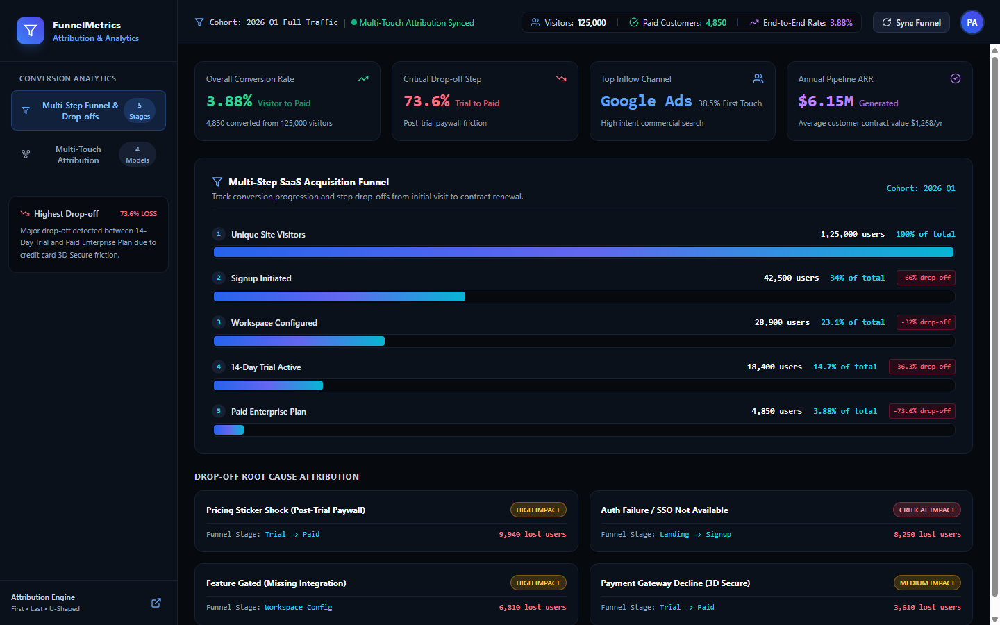

# Multi-Touch Marketing Attribution & Funnel Conversion Engine

[]()
[]()
[]()
[]()
[]()

> Multi-touch marketing attribution and multi-step user conversion funnel analytics platform for product analysts. Evaluates First-Touch, Last-Touch, Linear, and U-Shaped (position-based 40-20-40) models, detects step drop-off root causes, and tracks end-to-end ARR generation.

---

## 📸 Platform Dashboard



---

## ⚡ Core Product Analytics Capabilities

- **Multi-Step Conversion Funnel:** Visualizes step-by-step conversion progression across Unique Visitors (125k), Signup (42.5k), Workspace Config (28.9k), Active Trial (18.4k), and Paid Enterprise (4.85k).
- **Multi-Touch Marketing Attribution Comparison:** Compares First-Touch, Last-Touch, Linear, and U-Shaped models to appropriately credit discovery vs. closing marketing channels.
- **Drop-off Root-Cause Attribution:** Quantifies lost user volume categorized by pricing sticker shock, auth SSO friction, and 3D Secure payment declines.
- **ARR Channel Valuation:** Directly computes attributed ARR revenue for Google Search ($1.82M), LinkedIn B2B ($1.45M), and Email Nurture ($1.28M).

---

## 🏗️ Architecture & Attribution Modeling

```mermaid
flowchart LR
    A[Visitor Inflow\nGoogle • LinkedIn • SEO • Direct] --> B[Multi-Step Funnel Engine]
    B --> C{Step Drop-Off?}
    C -->|Drop-Off| D[Root-Cause Sentinel\nPaywall • Auth • 3DS Friction]
    C -->|Converted| E[Multi-Touch Attribution Engine]
    E --> F[First-Touch Model\nAcquisition Credit]
    E --> G[Last-Touch Model\nCloser Credit]
    E --> H[U-Shaped Model (40-20-40)\nPosition-Based ARR Sizing]
```

---

## 📊 Dataset Benchmark Reference

Bundled benchmark dataset located at `data/kaggle_funnel_conversion_attribution.csv`:

| Channel | First-Touch % | Last-Touch % | Linear % | U-Shaped % | Attributed ARR |
| :--- | :--- | :--- | :--- | :--- | :--- |
| Google Paid Search | 38.5% | 18.2% | 28.4% | 32.0% | $1.82M |
| LinkedIn Enterprise B2B | 29.0% | 12.5% | 22.1% | 26.5% | $1.45M |
| Email Dunning / Nurture | 2.1% | 34.8% | 18.5% | 14.2% | $1.28M |
| Organic Search / SEO Docs | 18.2% | 24.1% | 20.8% | 19.4% | $0.98M |
| Direct Word-of-Mouth | 12.2% | 10.4% | 10.2% | 7.9% | $0.62M |

---

## 🚀 Quickstart Guide

### Option 1: Docker Compose

```bash
git clone https://github.com/Prasunnandi/funnel-conversion-attribution.git
cd funnel-conversion-attribution
docker-compose up --build
```
- Web Dashboard: `http://localhost:3000`
- REST API: `http://localhost:8000`

### Option 2: Local Development

```bash
# 1. Start Backend API
cd backend
npm install
npm run dev

# 2. Start React Dashboard
cd ../frontend
npm install
npm run dev
```

---

## 🛠️ API Reference

- `GET /api/funnel` - Retrieves conversion rates and drop-off percentages across all 5 stages.
- `GET /api/attribution` - Compares First-Touch, Last-Touch, Linear, and U-Shaped models.
- `GET /api/drop-offs` - Root-cause breakdown of drop-off reasons and lost user volume.

---

## 📄 License

MIT © [Prasun Nandi](https://github.com/Prasunnandi)
